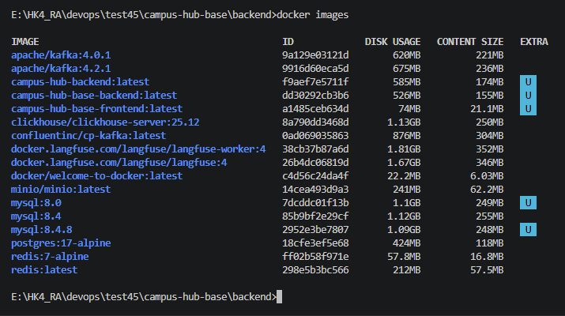
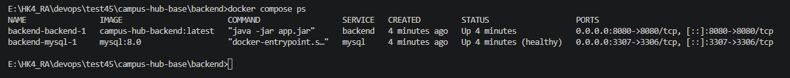
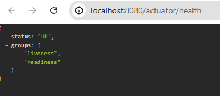
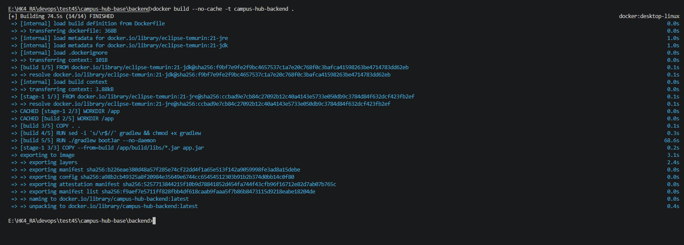
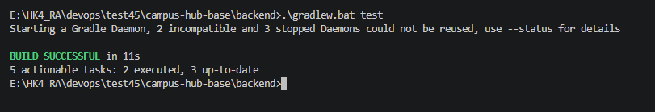

# Campus Hub — Docker

## Thông tin sinh viên

- Họ tên: Hà Thị Minh Trang

## Công nghệ sử dụng

- Java 21, Spring Boot
- Gradle
- Docker, Docker Compose
- MySQL 8.0

## Hướng dẫn chạy

Di chuyển đến backend:

```bash
cd backend
```

Kiểm thử Gradle:

```bash
./gradlew test
```

Build Docker Image:

```bash
docker build -t campus-hub-backend .
```

Chạy Docker Compose:

```bash
docker compose up -d
```

Kiểm tra container:

```bash
docker compose ps
```

## Kiểm tra Backend

- URL: http://localhost:8080/actuator/health
- Trạng thái mong muốn: HTTP 200 — UP
- Database: campus_hub_db
- MySQL service: mysql:3306

## Minh chứng

### 1. Docker Image



### 2. Docker Compose



### 3. Health Check



### 4. Build



### 5. Build gradlew


